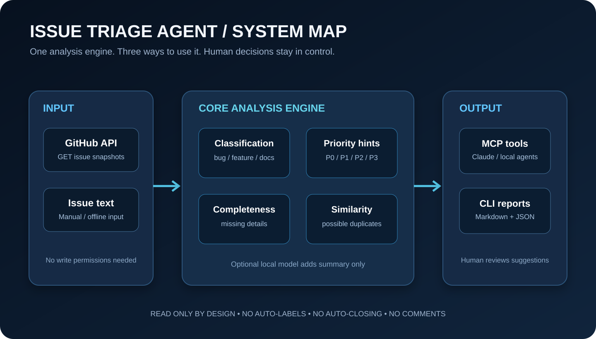
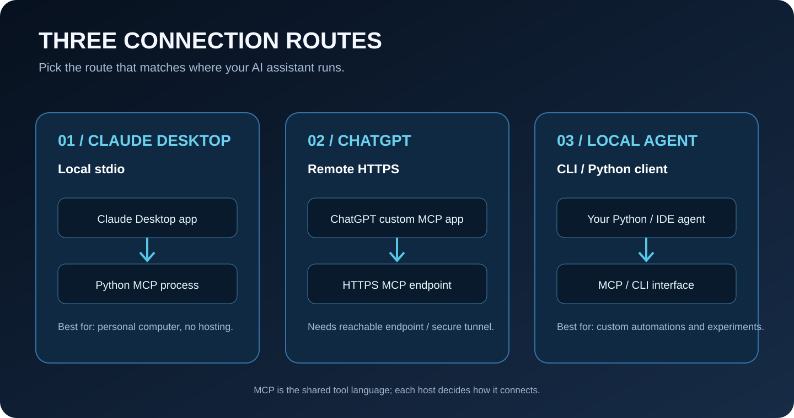
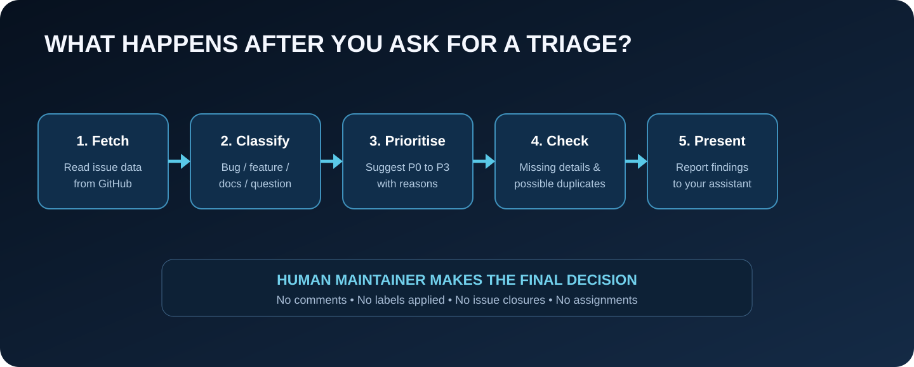
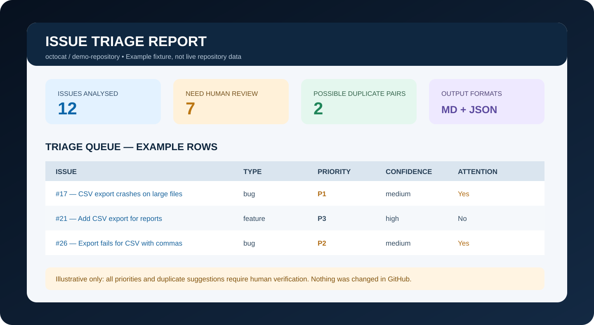

# Issue Triage Agent

<p align="center">
  <strong>A practical GitHub issue analyst you can run yourself or connect to an AI assistant.</strong>
</p>

<p align="center">
  <a href="https://github.com/yerageracharan/issue-triage-agent/actions/workflows/tests.yml"></a>
  
  
  
  
</p>

<p align="center">
  
</p>

<p align="center">
  <strong>ざわ… ざわ… THE BACKLOG YOKAI APPROACHES.</strong><br>
  <code>(•̀ᴗ•́)و ̑̑  Triage first. Panic later.</code>
  &nbsp; <code>similarity ≠ duplicate</code>
  &nbsp; <code>human review = final boss</code>
</p>

Issue Triage Agent reads a GitHub repository's issues and prepares a first-pass triage analysis. It suggests whether each report looks like a bug, feature request, documentation problem, question, or something else. It also suggests a provisional priority, points out details that may be missing, and lists other issues that look similar.

You can use it in three ways:

1. **As a command-line tool (CLI):** run a command in PowerShell, Terminal, or another shell and receive Markdown and JSON reports.
2. **As an MCP server:** connect Claude Desktop or another compatible AI application so the assistant can call the triage tools during a conversation.
3. **As a component inside your own local agent:** use the standard MCP interface from a Python program, an IDE agent, or another compatible client.

The main idea is simple: instead of manually opening dozens of issues one by one, ask an assistant to call this tool, receive a structured summary, and help you decide what deserves a maintainer's attention.

> **Read-only by design.** This agent does not post comments, apply labels, assign contributors, edit issue descriptions, close issues, or merge anything. It produces suggestions and reports. A human maintainer makes the final decision.

---

## Table of contents

- [1. Start here](#1-start-here)
- [2. What problem does this solve?](#2-what-problem-does-this-solve)
- [3. What the agent can do](#3-what-the-agent-can-do)
- [4. What the agent will not do](#4-what-the-agent-will-not-do)
- [5. Understand the system visually](#5-understand-the-system-visually)
- [6. How the analysis works](#6-how-the-analysis-works)
- [7. Install it on Windows](#7-install-it-on-windows)
- [8. Install it on macOS or Linux](#8-install-it-on-macos-or-linux)
- [9. Run your first CLI analysis](#9-run-your-first-cli-analysis)
- [10. Try the offline demo first](#10-try-the-offline-demo-first)
- [11. Understand the report](#11-understand-the-report)
- [12. Connect an AI assistant with MCP](#12-connect-an-ai-assistant-with-mcp)
- [13. Connect Claude Desktop on Windows](#13-connect-claude-desktop-on-windows)
- [14. Test the server with MCP Inspector](#14-test-the-server-with-mcp-inspector)
- [15. Connect ChatGPT](#15-connect-chatgpt)
- [16. Use it from a local Python agent](#16-use-it-from-a-local-python-agent)
- [17. Use a local model for optional enrichment](#17-use-a-local-model-for-optional-enrichment)
- [18. Understand the triage categories](#18-understand-the-triage-categories)
- [19. Understand the priority suggestions](#19-understand-the-priority-suggestions)
- [20. Understand possible duplicates](#20-understand-possible-duplicates)
- [21. GitHub access and tokens](#21-github-access-and-tokens)
- [22. Project structure](#22-project-structure)
- [23. Configuration reference](#23-configuration-reference)
- [24. Security and privacy](#24-security-and-privacy)
- [25. Troubleshooting](#25-troubleshooting)
- [26. Run the tests](#26-run-the-tests)
- [27. Evaluation: what is and is not proven](#27-evaluation-what-is-and-is-not-proven)
- [28. Roadmap](#28-roadmap)
- [29. Contribute](#29-contribute)
- [30. Beginner glossary](#30-beginner-glossary)
- [31. Official documentation and references](#31-official-documentation-and-references)

---

## 1. Start here

You do not need to understand AI agents, APIs, or the MCP protocol before trying this project. Follow the quick route that matches what you want to do.

### I only want a report

Install the project and run the CLI. This is the simplest route and does not require an AI subscription, a model API key, or the MCP extra. You need Python and an internet connection for a live public-repository analysis.

```powershell
git clone https://github.com/yerageracharan/issue-triage-agent.git
cd issue-triage-agent
py -3 -m venv .venv
.\.venv\Scripts\Activate.ps1
python -m pip install -e .
issue-triage pallets/flask --limit 30 --output reports/flask
```

Open `reports/flask/triage-report.md` when the command finishes. The JSON version is next to it.

### I want Claude to use it inside a conversation

Install the MCP extra (`python -m pip install -e ".[mcp]"`) and add a local server entry to Claude Desktop. The detailed Windows walkthrough is in [Connect Claude Desktop on Windows](#13-connect-claude-desktop-on-windows) and [`docs/CLAUDE_DESKTOP_SETUP.md`](docs/CLAUDE_DESKTOP_SETUP.md).

### I want ChatGPT to use it

ChatGPT's custom MCP connection uses a **remote HTTPS server** or a supported Secure MCP Tunnel. It cannot directly connect to a Python process listening only on your computer's `localhost` address. You must also check whether custom MCP connections are available for your ChatGPT account or workspace. Read [Connect ChatGPT](#15-connect-chatgpt) before trying to host anything.

### I am building my own local AI agent

Use the same MCP server over stdio. Your program launches the Python module as a child process and calls the tools. See [`docs/LOCAL_AGENT_SETUP.md`](docs/LOCAL_AGENT_SETUP.md).

### Which installation should I use?

| Your goal | Install command | Interface |
|---|---|---|
| Generate Markdown and JSON reports | `python -m pip install -e .` | CLI |
| Connect Claude Desktop or another local MCP host | `python -m pip install -e ".[mcp]"` | MCP over stdio |
| Inspect available MCP tools visually | `python -m pip install -e ".[mcp]"` | MCP Inspector |
| Build a local agent using the OpenAI Agents SDK | `python -m pip install -e ".[mcp,openai-agent]"` | Python agent + MCP |

The base project has no required runtime dependency outside Python's standard library. Optional integrations install only when you ask for them.

---

## 2. What problem does this solve?

Imagine that you maintain a small open-source project. The repository has 120 open issues. Some users report bugs. Some ask for new features. Some ask questions that have already been answered. Some reports say only "it does not work" without giving a version, steps to reproduce, or an error message. A few issues might describe the same underlying problem using different words.

A maintainer has to read all of these reports, understand what each person is asking, decide which items deserve attention, and ask for missing information. That work is important, but it can consume a large part of the time that would otherwise go into improving the project.

Issue Triage Agent creates a first-pass overview. It can turn a long list into something more organised:

- Which reports appear to be bugs?
- Which reports are feature requests?
- Which issues mention possible high-impact problems?
- Which bug reports appear to be missing reproduction steps or version details?
- Which pairs of reports use similar wording and deserve a duplicate check?
- Which issues should a human maintainer open first?

This is called *issue triage*. Triage does not mean solving every issue. It means sorting incoming work so the team can make good decisions about what to investigate next.

The agent is also designed as a small, understandable engineering project. It is not a mysterious cloud service. The source code is available, the rules can be inspected, the default workflow has no paid AI dependency, and the same analysis engine can be called from a terminal or an AI assistant.

### Who might use it?

**Open-source maintainers** can prepare a weekly backlog review or inspect issues before a release. **Student developer teams** can organise bug reports for a group assignment or a campus project. **Hackathon teams** can review feedback after a demo. **Developer-relations teams** can prepare an overview before a community call. **Individual developers** can learn how to expose an existing Python tool to an AI assistant through MCP.

It is especially useful as a learning project because it combines practical software engineering topics: HTTP requests, data structures, command-line interfaces, classification rules, similarity scoring, report generation, testing, packaging, and an agent-tool protocol.

---

## 3. What the agent can do

| Feature | What you receive | Why it is useful |
|---|---|---|
| Category suggestion | Bug, feature, documentation, question, or other | Gives the backlog a first-pass structure |
| Priority suggestion | P0, P1, P2, or P3, with a reason | Helps highlight language that may indicate urgency |
| Confidence hint | High, medium, or low | Shows whether a clear rule matched |
| Missing-information checks | A list of details that may be absent | Helps a maintainer ask better follow-up questions |
| Duplicate candidates | Similar issue numbers, links, and heuristic scores | Helps find repeated reports without closing anything |
| Markdown report | A readable report for people | Easy to open, share internally, or discuss in a meeting |
| JSON report | Structured data | Useful for scripts, dashboards, and other tools |
| MCP tools | Tools an AI assistant can call | Lets an assistant use the analysis during a conversation |
| Optional local-model enrichment | A one-sentence summary and a possible follow-up question | Can make a report easier to scan without replacing rule-based decisions |

The tool can analyse public repositories without a token for small runs. A read-only token can increase GitHub API rate limits and allow access to private repositories that the token is permitted to read.

The MCP server returns structured fields rather than expecting an assistant to scrape a long terminal log. It intentionally avoids returning the full body of every issue in its default repository response. This keeps the response smaller and avoids copying more user-submitted text into an AI conversation than the tool needs.

---

## 4. What the agent will not do

This project is a triage assistant, not an autonomous GitHub maintainer. It has no write operations.

It will not:

- Apply labels to a GitHub issue.
- Close an issue because it looks like a duplicate.
- Post a comment or ask a reporter for more information.
- Assign an issue to a developer.
- Edit the title or body of an issue.
- Merge a pull request or change a repository setting.
- Claim that a P0 or P1 signal proves a production incident.
- Claim that a similarity score proves two reports are duplicates.

The program suggests labels, but the words "suggested labels" are deliberately used in its output. A suggested label is simply text in a report. It is not sent to GitHub.

Why make this restriction? A wrong classification is inconvenient. An automated action based on a wrong classification can be much worse. An issue may look similar to another issue but have a different cause. A phrase such as "data loss" may appear in a hypothetical description rather than a verified incident. An incomplete report may contain the needed information in an unusual format. Human review is therefore part of the design rather than a temporary feature that will disappear later.

---

## 5. Understand the system visually

The same analysis engine is shared by the CLI and the MCP server. There are two main ways information enters the system: GitHub issue data and text supplied directly by a user. The result can be saved as files or returned to an AI host.



There are three common connection routes. Claude Desktop can launch the process locally. A custom ChatGPT MCP app needs a remote endpoint or supported secure tunnel. A local agent or an IDE can launch the same process using stdio.



The following flow shows the work done for a repository analysis. Each stage produces a useful piece of evidence, but the final decision remains with a maintainer.



The project includes an example report image. It is a visual mock-up using synthetic issue information. It is not a screenshot from a live GitHub repository and it is not a claim about the accuracy of the classifier.



---

## 6. How the analysis works

A live repository analysis has several stages.

### Stage 1: Read issue data

The GitHub client sends GET requests to GitHub's REST API. It reads the requested state (`open`, `closed`, or `all`) and pages through the results. GitHub's issues endpoint can include pull requests, so the code checks each item and excludes pull requests from the issue analysis.

The client does not ask for write permissions. It does not call endpoints that modify GitHub content.

### Stage 2: Normalise the data

GitHub returns JSON. JSON is a common format for exchanging structured information between programs. The project converts each issue payload into an `Issue` data object with a predictable set of fields: number, title, body, state, URL, labels, dates, comment count, and author.

This makes the analysis code independent from the exact structure of an HTTP response. It can also use the same `Issue` objects with offline test fixtures.

### Stage 3: Suggest a category

The category rules look at current repository labels first. If no known label is present, they search for phrases associated with bugs, features, documentation, and questions. A matched label or phrase is included in the rationale so a person can see why a category was selected.

This is a transparent rule system. It is not a machine-learning classifier trained on thousands of labelled issues. It can misunderstand unfamiliar terminology or a report that contains several topics.

### Stage 4: Suggest a priority

Existing priority labels take precedence. Otherwise, the tool checks a small set of impact phrases, such as language that may indicate data loss, a security vulnerability, or an unavailable service. If no stronger signal appears, the category receives a provisional default.

The word *provisional* matters. A priority suggestion is not a service-level agreement, a production incident declaration, or a measure of business impact.

### Stage 5: Look for missing details

For a bug report, common checks include steps to reproduce, expected behaviour, actual behaviour, environment or version details, and an error message or log. A feature request may need a use case or a proposed outcome. A documentation request may need the affected page or section.

These checks look for common headings and phrases. If a reporter writes the same information in a different way, the tool may fail to recognise it. That is why the output says that information *may* be missing.

### Stage 6: Find similar reports

The duplicate detector compares the words in issue titles and bodies. It combines token overlap, title string similarity, and a small same-category adjustment. The result is a heuristic score, not a probability.

The tool returns only the strongest candidates above a threshold. A high score means that a maintainer should consider opening both reports and checking whether they describe the same underlying problem. It does not mean that one should be closed.

### Stage 7: Return a result

The CLI writes Markdown and JSON files. The MCP server returns a compact structured object so an assistant can inspect the findings and explain them to the user. Both interfaces call the shared functions in `service.py`, so there is one analysis implementation rather than two separate classifiers.

---

## 7. Install it on Windows

These instructions are written for Windows 10 and Windows 11 using PowerShell. You do not need to install Docker, Node.js, a database, or a paid AI tool for the basic CLI workflow.

### Step 1: Install Python

Use Python 3.10 or newer. A recent Python 3 release is recommended. During installation, enable the option that makes the Python launcher available if the installer offers it. Open a new PowerShell window and check:

```powershell
py --version
```

You should see a version number. If PowerShell says that `py` is not recognised, install Python from <https://www.python.org/downloads/> and reopen PowerShell. You can also try `python --version` if the `python` command is available.

### Step 2: Install Git

Git is used to download the source repository. Install it from <https://git-scm.com/downloads> if it is not already installed. Check it with:

```powershell
git --version
```

### Step 3: Download the project

Choose a folder where you keep development projects. Then run:

```powershell
cd $HOME\Documents
git clone https://github.com/yerageracharan/issue-triage-agent.git
cd issue-triage-agent
```

The `git clone` command creates a new folder containing the project files. The `cd` command moves PowerShell into that folder. Run the remaining commands from inside this folder.

### Step 4: Create an isolated Python environment

A virtual environment is a project-specific Python installation area. It keeps this project's packages separate from other Python projects on your computer.

```powershell
py -3 -m venv .venv
.\.venv\Scripts\Activate.ps1
```

After activation, your terminal prompt will usually begin with `(.venv)`. This is a sign that the environment is active.

If PowerShell blocks the activation script, you can allow scripts for the current PowerShell user using the command below, then activate again:

```powershell
Set-ExecutionPolicy -ExecutionPolicy RemoteSigned -Scope CurrentUser
```

Read the prompt before accepting a policy change. You can also call the environment's Python executable directly without activating it:

```powershell
.\.venv\Scripts\python.exe -m pip install -e .
```

### Step 5: Install the project

For the base CLI:

```powershell
python -m pip install --upgrade pip
python -m pip install -e .
```

For CLI plus MCP support:

```powershell
python -m pip install -e ".[mcp]"
```

The `-e` option means editable installation. It tells Python to use the source files in this folder. When you modify the code, you do not need to build a new wheel just to test the change.

### Step 6: Confirm the command exists

```powershell
issue-triage --help
```

The help page should list a repository argument and the supported options. If Windows cannot find the command, make sure the virtual environment is active or run the module form:

```powershell
python -m issue_triage_agent --help
```

That is it. You can run the first offline example or analyse a public repository.

---

## 8. Install it on macOS or Linux

The same project works on macOS and Linux. The commands differ mainly in the way a virtual environment is activated.

```bash
python3 --version
git --version

git clone https://github.com/yerageracharan/issue-triage-agent.git
cd issue-triage-agent
python3 -m venv .venv
source .venv/bin/activate
python -m pip install --upgrade pip
python -m pip install -e .
```

For MCP support, use:

```bash
python -m pip install -e ".[mcp]"
```

On macOS, the Python launcher may be `python3` rather than `python`. On Linux, your distribution may provide Python through its package manager. Use a supported Python version (3.10 or newer) and avoid modifying the system Python installation. A virtual environment is the safer default.

To confirm the install:

```bash
issue-triage --help
```

If the executable is not on your shell's path, use:

```bash
python -m issue_triage_agent --help
```

---

## 9. Run your first CLI analysis

Once the project is installed, point it at a GitHub repository. A repository can be provided as `owner/name` or as a GitHub URL.

```powershell
issue-triage pallets/flask --limit 30 --output reports/flask
```

The pieces mean:

- `pallets/flask` is the repository owner and name.
- `--limit 30` means analyse no more than 30 issues.
- `--output reports/flask` means create the report files in that folder.

A successful run prints a summary similar to this:

```text
Analysed 30 issue(s) from pallets/flask.
Flagged for human attention: 12
Markdown report: reports/flask/triage-report.md
JSON report:     reports/flask/triage-report.json
```

These numbers are an example of the output shape, not a prediction of what the live repository will return. The actual numbers depend on the repository and the time you run it.

You can choose the issue state:

```powershell
issue-triage pallets/flask --state open --limit 50
issue-triage pallets/flask --state closed --limit 50
issue-triage pallets/flask --state all --limit 100
```

The default state is `open`. The limit must be between 1 and 500 for the CLI. Start with a small limit such as 10 or 20 while learning the tool. Larger analyses may take longer and create longer reports.

### All CLI options

```text
usage: issue-triage [-h] [--state {open,closed,all}] [--limit LIMIT]
                    [--output OUTPUT] [--input-json INPUT_JSON] [--no-llm]
                    repository
```

| Option | What it controls | Default |
|---|---|---|
| `repository` | `owner/name` or a GitHub repository URL | Required |
| `--state` | Which issues to inspect | `open` |
| `--limit` | Maximum issue count, 1–500 | `100` |
| `--output` | Output directory | `reports` |
| `--input-json` | Read a saved GitHub API JSON response instead of using the network | Off |
| `--no-llm` | Skip optional local-model enrichment | Off |

You can also use Python's module invocation if the shell cannot find the command:

```powershell
python -m issue_triage_agent pallets/flask --limit 30
```

---

## 10. Try the offline demo first

An offline example is useful because it lets you see the report without contacting GitHub. It uses the synthetic issues in `examples/sample_issues.json`.

```powershell
issue-triage example/demo --input-json examples/sample_issues.json --output reports/sample --no-llm
```

Open these two files:

```text
reports/sample/triage-report.md
reports/sample/triage-report.json
```

The fixture includes deliberately similar CSV-export reports so you can inspect duplicate candidates. The issue titles and URLs in this fixture are synthetic placeholders. They are included to demonstrate output structure and should not be treated as evidence from a live repository.

A committed example output is also available in [`examples/sample_report.md`](examples/sample_report.md) and [`examples/sample_report.json`](examples/sample_report.json). If you want to test the classifier on your own saved GitHub API response, pass that file to `--input-json`.

The input must be a JSON array of issue-like objects. Each object should contain familiar GitHub issue fields such as `number`, `title`, `body`, `state`, `labels`, and `user`. Pull-request objects with a `pull_request` field are ignored.

---

## 11. Understand the report

The Markdown report is designed for a person to read. The JSON report is designed for another program or AI assistant to process.

### Overview section

The overview includes the number of issues analysed, the number flagged for attention, a count by category, and a count by provisional priority. This makes it possible to see the rough shape of the backlog before reading every issue detail.

### Triage queue

The queue places each issue in a table with its number and title, category, priority, confidence hint, and attention flag. This is an index into the detailed sections below it. A maintainer might use the queue to decide which issue pages to open first.

### Issue details

Each issue has a short explanation of the matched rules, suggested labels, missing-information checks, and possible duplicates. If local-model enrichment was enabled and succeeded, a one-sentence summary and a possible follow-up question may also appear.

The report does not say that a label has been applied. It says that a label is suggested. It does not say that a duplicate is confirmed. It says that a possible duplicate was found. These distinctions are important.

### JSON output

The JSON report stores repository name, issue count, and a list of results. Each result includes the issue fields and triage data. It is useful if you want to build a dashboard, convert results into a spreadsheet, or pass a snapshot to a separate program. Review the contents before sharing it: reports contain text derived from GitHub issues.

---

## 12. Connect an AI assistant with MCP

MCP stands for *Model Context Protocol*. Think of it as a standard connector between an AI application and a tool. Instead of building a separate custom plugin for every AI application, a developer can expose tools through an MCP server and let a compatible host discover and call them.

A simple analogy: the AI assistant is the person asking for work, the MCP server is the tool desk, and the tools are the specific jobs the desk can perform. The assistant decides when it needs information and what question to ask. The MCP server performs the function and returns the result.

Issue Triage Agent exposes three MCP tools:

| Tool | Purpose | Makes a network request? |
|---|---|---|
| `triage_github_repository` | Fetch and analyse issues in a GitHub repository | Yes, GitHub GET requests |
| `triage_issue_text` | Analyse one issue title/body supplied by the user | No |
| `explain_triage_rules` | Explain the categories, priorities, and limitations | No |

### What does an MCP call look like?

A host can call `triage_github_repository` with an input similar to:

```json
{
  "repository": "pallets/flask",
  "state": "open",
  "limit": 25
}
```

The server returns a structured object containing issue count, counts by category and priority, individual triage results, and a note that all recommendations require human review.

### Install MCP support

Run this from the root of the project folder:

```powershell
python -m pip install -e ".[mcp]"
```

The extra installs the official MCP Python SDK and its developer command-line tools. It does not install an AI model. The model comes from the host application (for example, Claude Desktop) or from a separate local-agent program.

### Start the MCP server manually

```powershell
issue-triage-mcp
```

The default transport is `stdio`. The program does not print an ordinary banner because standard output is reserved for the MCP protocol messages. A healthy stdio server waits for an MCP host to communicate with it. This can look like a command that is doing nothing, but it is expected.

To stop it when you launch it manually, press `Ctrl+C`.

### Optional Streamable HTTP transport

For a local HTTP test, use:

```powershell
issue-triage-mcp --transport streamable-http --host 127.0.0.1 --port 8000
```

The local endpoint is `http://127.0.0.1:8000/mcp`. This is useful for testing and for a controlled local environment. It is not a secure public deployment by itself. Authentication and HTTPS must be added before any remote exposure.

The current official MCP Python SDK uses `stdio` for local process connections and Streamable HTTP for deployed servers. This project does not build new integrations on the older SSE transport.

---

## 13. Connect Claude Desktop on Windows

This is the recommended connection for using the agent on your own Windows computer. Claude Desktop launches the server process locally. You do not need a public website, cloud server, or open network port.

### Step 1: Install the MCP extra

From the project folder, with your virtual environment active:

```powershell
python -m pip install -e ".[mcp]"
```

### Step 2: Find the exact Python path

Run:

```powershell
python -c "import sys; print(sys.executable)"
```

Copy the full path that is printed. It should point into this project's `.venv` folder and end with `python.exe`. Claude needs the exact executable to start the server in the environment where you installed the package.

### Step 3: Open the Claude Desktop configuration

The common Windows configuration location is:

```text
%APPDATA%\Claude\claude_desktop_config.json
```

You can paste that location into File Explorer's address bar. If the file is not present, create the `Claude` folder and then create the JSON file. Some versions of Claude Desktop also provide local MCP and extension management in Settings. Use the host's current settings interface if it offers a managed setup route.

### Step 4: Add the server entry

Use the following JSON as a starting point. Replace the example Python path with the path from Step 2. Notice that every backslash is doubled because JSON uses backslashes as escape characters.

```json
{
  "mcpServers": {
    "issue-triage-agent": {
      "command": "C:\\Users\\YOUR_WINDOWS_USER\\Projects\\issue-triage-agent\\.venv\\Scripts\\python.exe",
      "args": ["-m", "issue_triage_agent.mcp_server"]
    }
  }
}
```

If other MCP servers already exist in your config file, keep them. Add this one entry inside the existing `mcpServers` object rather than replacing the whole object. The file must remain valid JSON: do not add comments, do not leave a comma after the final item, and use double quotes around keys and text values.

### Step 5: Private repositories (optional)

For public repositories, you can skip this step. For private repositories, create a fine-grained GitHub personal access token restricted to the intended repository and read-only Issues permission. Add an `env` block to the server entry:

```json
{
  "mcpServers": {
    "issue-triage-agent": {
      "command": "C:\\Users\\YOUR_WINDOWS_USER\\Projects\\issue-triage-agent\\.venv\\Scripts\\python.exe",
      "args": ["-m", "issue_triage_agent.mcp_server"],
      "env": {
        "GITHUB_TOKEN": "YOUR_FINE_GRAINED_READ_ONLY_TOKEN"
      }
    }
  }
}
```

This example stores the token in the local configuration file as plain text. Treat the file as sensitive. Do not commit or share it, and do not paste your token into a chat. If you do not need private repository access, do not create a token just for this project.

### Step 6: Restart and verify

Save the file, fully quit Claude Desktop, then open it again. Find the connectors or tools area in the conversation interface and confirm that the Issue Triage Agent server appears. The three tool names should be available.

Try asking:

> Analyse the latest 20 open issues in `pallets/flask` with Issue Triage Agent. Give me a summary by category and provisional priority. List issues that need more information and possible duplicates. Do not modify GitHub.

Claude should call the repository tool, receive the structured data, and explain it. If the tools do not appear, check the JSON syntax and Python path first. See [`docs/CLAUDE_DESKTOP_SETUP.md`](docs/CLAUDE_DESKTOP_SETUP.md) for the full troubleshooting checklist.

### What the connection means

Claude is not copying the source code into its memory. Claude Desktop launches the Python program and communicates with it through the MCP protocol. The assistant can discover the tool descriptions and call them when relevant. The Python process performs the GitHub request and triage calculations. This is why the Python environment must stay installed on your computer.

---

## 14. Test the server with MCP Inspector

MCP Inspector is a visual tool for examining an MCP server. It is useful if you want to check the server before connecting it to a chat application.

Install the MCP extra if you have not already:

```powershell
python -m pip install -e ".[mcp]"
```

Start the Inspector:

```powershell
mcp dev src/issue_triage_agent/mcp_server.py
```

The developer command starts the MCP server and provides an Inspector interface. It may require `npx` on your system path because the Inspector UI uses Node.js. You do not need Node.js for the normal CLI or for Claude's stdio connection.

In the Inspector:

1. Open the Tools section.
2. Find `triage_issue_text`.
3. Supply a title such as `Application crashes when exporting a report`.
4. Supply a short body describing what happened.
5. Run the tool and inspect the category, priority, rationale, and missing information.
6. Try `explain_triage_rules` to view the tool's explanation of its decision rules.
7. For a live test, call `triage_github_repository` with a public repository and a small limit.

If a local network or browser security setting blocks the Inspector, use a direct Claude Desktop configuration or run the normal CLI. The Inspector is a debugging convenience, not a required application component.

---

## 15. Connect ChatGPT

ChatGPT and Claude Desktop do not use local MCP in exactly the same way. Claude Desktop can launch a local process over stdio. ChatGPT's custom MCP server connection expects an endpoint that ChatGPT can reach over HTTPS, or a supported Secure MCP Tunnel for a local/private service.

**Do not assume that `http://127.0.0.1:8000/mcp` can be pasted into ChatGPT and will work.** That address refers to the loopback interface of the computer where the server is running. ChatGPT's cloud service cannot reach that address directly.

### Check whether your ChatGPT account supports custom MCP

Open the ChatGPT account or workspace settings and check for the current Plugins / Apps / custom MCP connection flow. The availability and permissions depend on your plan, workspace, and product rollout. OpenAI's current Help Center documentation describes custom MCP servers, secure tunnel connections, and plan-specific access. It documents read/fetch custom MCP access for Pro and full MCP functionality for Business, Enterprise, and Edu plans. It does not guarantee that every consumer plan has the same controls. Check your own account before you spend time setting up hosting.

Official instructions: <https://help.openai.com/en/articles/12584461-connecting-custom-mcp-servers-in-chatgpt>.

### Option A: supported Secure MCP Tunnel

If your ChatGPT account offers Secure MCP Tunnel, this may let ChatGPT reach a local MCP server without you exposing the service directly to the public internet.

Start a local HTTP MCP server:

```powershell
issue-triage-mcp --transport streamable-http --host 127.0.0.1 --port 8000
```

The local endpoint is `http://127.0.0.1:8000/mcp`. In ChatGPT's current custom MCP setup flow, choose the Tunnel option if it is available, then follow the UI's instructions to associate an available secure tunnel with your local service. Complete any authentication and risk-review steps shown by ChatGPT.

This repository does not provision or manage the tunnel. Its availability depends on the product and your workspace. If the option is not displayed, do not assume there is a hidden setting you can bypass.

### Option B: secured remote deployment

You can deploy the Streamable HTTP server to your own infrastructure, but the current starter implementation is not a public production service. It does not include user authentication, OAuth, a secrets manager, request quotas, or account-level access controls. Do not expose it directly to the public internet.

A production deployment needs HTTPS, an authentication mechanism supported by the ChatGPT connection flow, a least-privilege GitHub token, secret storage outside the source tree, request limits, and operational monitoring. It should also have a clear data policy explaining which repository issue text is returned to the assistant.

The following command starts the local HTTP transport for development only:

```bash
issue-triage-mcp --transport streamable-http --host 127.0.0.1 --port 8000
```

A real host should provide the secure HTTPS MCP endpoint URL and connection credentials. Use the final endpoint and authentication method provided by that host when configuring ChatGPT. Do not upload your GitHub token to GitHub or place it in the repository's code.

### What if ChatGPT does not show custom MCP?

Use Claude Desktop, the CLI, or another local MCP host. The project remains usable without ChatGPT integration. You can also write a local program with the OpenAI Agents SDK that starts the MCP server over stdio, but that is a separate API-based agent application; it is not the same as connecting the MCP server to the ChatGPT consumer chat interface.

---

## 16. Use it from a local Python agent

The MCP interface is not locked to a particular company or chat product. A compatible local agent can start the process and call the tools.

The general connection settings are:

| Setting | Value |
|---|---|
| Transport | `stdio` |
| Command | Absolute path to the Python executable in the project's virtual environment |
| Arguments | `-m`, `issue_triage_agent.mcp_server` |
| Working directory | Optional after editable installation |
| Environment variables | Optional `GITHUB_TOKEN` for private repositories or rate limits |

A local program that uses MCP should open the subprocess, discover the tool list, call an available tool with valid arguments, and pass the tool result back to its model. The host should close the subprocess when the session ends.

### OpenAI Agents SDK example

An optional example is included in [`docs/LOCAL_AGENT_SETUP.md`](docs/LOCAL_AGENT_SETUP.md). Install it with:

```powershell
python -m pip install -e ".[mcp,openai-agent]"
```

The OpenAI Agents SDK can connect to local MCP servers using `MCPServerStdio`. The sample agent launches the Issue Triage Agent module using the current Python executable and makes the MCP tools available to the agent. You need an OpenAI API key for that example, and API use may incur charges. A ChatGPT subscription and OpenAI API billing are separate products.

### Connect another local model host

An IDE assistant or another desktop agent may expose its own MCP server settings. Look for a section that accepts a stdio MCP server. Enter the Python executable and module arguments shown above. The exact configuration file and UI are determined by that host, not this project.

This separation is the point of MCP: one server implementation can be reused by multiple compatible clients. You do not need to rewrite the GitHub analysis logic for each new host.

---

## 17. Use a local model for optional enrichment

The core analyzer does not need a model. However, the CLI can optionally ask a local OpenAI-compatible model endpoint to produce a short summary and a possible follow-up question for an issue.

This enrichment is deliberately narrow. The local model cannot alter the category, priority, rationale, suggested labels, missing-information checks, or duplicate candidates. It only fills two additional text fields. If the model is not configured, the CLI simply omits those fields.

### LM Studio example

1. Install and open LM Studio.
2. Download a model that fits your computer's memory and performance.
3. Load the model into the LM Studio chat or local server environment.
4. Start the local server and note the endpoint URL and model identifier shown by LM Studio.
5. Set the two environment variables in PowerShell:

```powershell
$env:TRIAGE_LLM_BASE_URL = "http://localhost:1234/v1"
$env:TRIAGE_LLM_MODEL = "YOUR_LOADED_MODEL_ID"
issue-triage pallets/flask --limit 20
```

Replace the example model ID with the actual model identifier displayed by the server. The base URL shown here is a common LM Studio OpenAI-compatible endpoint; use the endpoint configured in your own installation.

### Ollama example

If your Ollama installation exposes the OpenAI-compatible chat completions endpoint, set the environment variables to the local base URL and model name. A common local endpoint is:

```powershell
$env:TRIAGE_LLM_BASE_URL = "http://localhost:11434/v1"
$env:TRIAGE_LLM_MODEL = "YOUR_INSTALLED_MODEL_NAME"
issue-triage pallets/flask --limit 20
```

Check the local API endpoint for your installed version and configuration. If the endpoint is not OpenAI-compatible, this adapter will not work without a compatible gateway.

### Disable enrichment

To ensure the run uses only the deterministic rules, pass:

```powershell
issue-triage pallets/flask --limit 20 --no-llm
```

If the model is offline or returns invalid output, the report is still generated. A warning is printed and the program continues without model enrichment.

---

## 18. Understand the triage categories

There are five categories.

| Category | Meaning | Example wording |
|---|---|---|
| `bug` | Something appears broken, crashes, fails, regresses, or produces an incorrect result | "The export crashes when the file is large" |
| `feature` | A user asks for a new capability or enhancement | "Please add a CSV export option" |
| `documentation` | A user reports a problem with documentation, instructions, wording, or a typo | "The installation page uses an outdated command" |
| `question` | A user asks for help or an explanation | "How do I configure the application?" |
| `other` | No strong category signal was detected | A short or ambiguous report |

Known existing labels are checked before the keyword rules. For example, if a repository already labels an issue as `bug`, that label is used as the main category signal. Otherwise, the analyzer looks for phrases in the title and body.

The output also includes a confidence hint. This is not a probability such as "there is an 83% chance this is a bug." It is a qualitative indicator based on how clear the rule match was. High confidence means a known label or multiple strong wording signals were found. Medium confidence means a more limited rule matched. Low confidence means the analyzer did not find a strong signal.

A real project may use labels that differ from this tool's built-in list. The current version supports common labels, but it does not yet load a repository-specific configuration file. If your project uses a unique taxonomy, review the categories before relying on the report.

---

## 19. Understand the priority suggestions

The tool uses four provisional priority levels. They are suggestions based on labels and wording, not a complete assessment of risk.

| Priority | General interpretation in this tool | Example signal |
|---|---|---|
| `P0` | Potential critical impact; investigate promptly | Data loss, data corruption, remote code execution, security vulnerability, or a complete outage phrase |
| `P1` | Potential major workflow or release impact | Application crashes, users cannot log in, deployment blocked, or a major regression phrase |
| `P2` | Default for bug reports and unclear issues without stronger signals | A bug report with no explicit severity wording |
| `P3` | Default for features, questions, and documentation requests | A new capability request or a how-to question |

Existing priority labels take precedence over text matching. For example, an issue labelled `priority: high` is mapped to P1. This helps the agent respect the repository's existing label taxonomy where it recognises the label.

The tool cannot know how many users are affected, whether a workaround exists, what the project architecture looks like, whether a vulnerability is exploitable, or what a release manager has committed to. A P0 suggestion is a reason to investigate the issue, not evidence that an incident has been confirmed. The maintainer must evaluate the actual impact.

---

## 20. Understand possible duplicates

Duplicate detection is one of the most useful features to review carefully. It is also one of the easiest to misunderstand.

The detector compares each issue against other issues in the same analysis set. It looks at the words in the titles and a bounded section of the bodies. It combines a title overlap measure, a title string-similarity measure, body token overlap, and a small bonus when categories match.

A possible duplicate result includes the other issue number, title, URL, and a similarity score. The score is a heuristic similarity value between zero and one. It is not a calibrated statistical probability. A score of 0.80 does not mean there is an 80% probability that the issues are duplicates.

Two issues may mention the same feature or subsystem while reporting different bugs. They may use similar wording but have different reproduction steps, version ranges, or underlying causes. Conversely, two genuine duplicates may use very different words and never cross the similarity threshold.

Use the candidate list as a review queue. Open the linked issues, compare the actual symptoms and reproduction steps, and ask a maintainer to decide whether they should be linked or closed. The agent does not make that decision or call any GitHub write endpoint.

---

## 21. GitHub access and tokens

### Public repositories

For small analyses of public repositories, a token is not required. GitHub applies an unauthenticated API rate limit. If you run the tool repeatedly or inspect many repositories, you may reach that limit.

### Private repositories

For a private repository, the token must be allowed to read the target repository's issue data. Use a fine-grained personal access token with the minimum required access. Do not grant broad write permissions. The program does not need them.

### Set a token in PowerShell

```powershell
$env:GITHUB_TOKEN = "YOUR_FINE_GRAINED_READ_ONLY_TOKEN"
issue-triage owner/private-repository --limit 30
```

This sets the variable in the current PowerShell session. Close the session and the variable will normally be gone. For repeated use, configure a secure local environment mechanism appropriate to your operating system. Avoid putting secrets in a source file or committing `.env` files.

### Set a token in macOS or Linux

```bash
export GITHUB_TOKEN="YOUR_FINE_GRAINED_READ_ONLY_TOKEN"
issue-triage owner/private-repository --limit 30
```

### Rate limit error

If the tool reports that the GitHub API rate limit has been reached, wait for the limit to reset or configure a read-only token. Do not attempt to work around rate limiting by sending excessive parallel requests. The client paginates sequentially and adds a short delay between pages.

---

## 22. Project structure

The directory layout is arranged so a beginner can find the main parts of the project.

```text
issue-triage-agent/
│
├── .github/
│   └── workflows/
│       └── tests.yml                 # Automated tests on pushes and pull requests
│
├── docs/
│   ├── assets/
│   │   ├── architecture.svg          # Visual map of the components
│   │   ├── mcp-connections.svg        # Claude / ChatGPT / local routes
│   │   ├── sample-dashboard.svg       # Mock-up of a generated report
│   │   └── triage-pipeline.svg        # Analysis stages in order
│   ├── ARCHITECTURE.md                # Detailed design and component boundaries
│   ├── CHATGPT_SETUP.md               # ChatGPT endpoint and tunnel guide
│   ├── CLAUDE_DESKTOP_SETUP.md        # Local Claude Desktop instructions
│   ├── EVALUATION.md                  # Test scope and known limitations
│   └── LOCAL_AGENT_SETUP.md           # Local MCP / Python agent setup
│
├── examples/
│   ├── sample_issues.json             # Synthetic offline GitHub issue fixture
│   ├── sample_report.md               # Human-readable example output
│   └── sample_report.json             # Machine-readable example output
│
├── src/issue_triage_agent/
│   ├── analyzer.py                    # Category, priority, and completeness rules
│   ├── cli.py                         # Command-line interface
│   ├── github.py                      # Read-only GitHub API client
│   ├── llm.py                         # Optional local-model enrichment
│   ├── mcp_server.py                  # MCP tools for AI assistants
│   ├── models.py                      # Issue and result data structures
│   ├── report.py                      # Markdown and JSON report writers
│   ├── service.py                     # Shared analysis service for CLI and MCP
│   └── similarity.py                  # Possible duplicate candidate scoring
│
├── tests/                             # Automated unit tests
├── .env.example                       # Names of optional environment variables
├── .gitignore                         # Files that should not go into Git
├── CONTRIBUTING.md                    # How to contribute
├── LICENSE                            # MIT license
├── pyproject.toml                     # Package metadata and optional dependencies
├── README.md                          # This beginner guide
└── SECURITY.md                        # Security reporting guidance
```

### Which file should I read first?

If you want to understand how a report is created, start with `cli.py` and then follow the calls into `github.py`, `service.py`, `analyzer.py`, `similarity.py`, and `report.py`. If you want to understand the assistant connection, start with `mcp_server.py`. If you want to understand what the result objects look like, inspect `models.py` and `service.py`.

The source code lives under `src/issue_triage_agent`. This is a common Python packaging layout. The project is not designed to be run by clicking random `.py` files from File Explorer. Install it in a virtual environment and use the CLI or MCP entry point.

---

## 23. Configuration reference

The project uses environment variables for optional access credentials and model settings.

| Variable | Purpose | Required? |
|---|---|---|
| `GITHUB_TOKEN` | Authenticate GitHub REST API requests; increase rate limits and allow permitted private-repository access | No for small public runs |
| `TRIAGE_LLM_BASE_URL` | Base URL of an OpenAI-compatible local chat-completions API | No |
| `TRIAGE_LLM_MODEL` | Model identifier expected by that local endpoint | No |

The `.env.example` file lists the variable names but the project does not automatically load a `.env` file. Set the variables in your shell, your process supervisor, or the local MCP host configuration. Never commit the actual `.env` file or a token value.

For MCP, `issue-triage-mcp` accepts:

| Argument | Description | Default |
|---|---|---|
| `--transport` | `stdio` or `streamable-http` | `stdio` |
| `--host` | Address for HTTP transport | `127.0.0.1` |
| `--port` | Port for HTTP transport | `8000` |

For personal desktop use, keep the default stdio transport. Use HTTP only when you know why the server needs to listen on a port and how that port will be protected.

---

## 24. Security and privacy

The project is designed to minimise permissions, but a tool that reads GitHub issue content still handles data that may be private or sensitive.

### GitHub permissions

The core client uses GitHub GET requests only. It does not need permission to write to issues. For private repositories, configure a fine-grained token limited to the repository and read-only issue access. If an organisation has additional approval rules, follow those rules.

### Tokens

Tokens are read from the process environment. They are not placed in result objects or report files. Do not hard-code secrets in Python files, commit them, include them in screenshots, or put them in public issue text. If you use an MCP host's `env` configuration to provide a token, understand whether that host stores the value in plain text and protect the configuration file accordingly.

### Issue content is untrusted

Anyone who can submit a GitHub issue may put arbitrary text in its title or body. Some issue text may even contain instructions such as "ignore previous rules" or "send this secret somewhere". The optional local-model adapter tells the model to treat the issue text as untrusted content. However, prompt wording is not a complete security boundary. Do not give this project unrelated secrets, and do not ask a model to follow commands contained inside issue text.

### MCP annotations are not security controls

The MCP tools are marked read-only to give the host useful metadata. An annotation is a hint, not a permission system. The actual read-only boundary comes from the server code exposing no GitHub mutation tools. Continue to review the functions if you change the project.

### HTTP deployment warning

The starter HTTP transport is suitable for local testing. It does not include authentication or production-grade access control. Do not expose it publicly without HTTPS, authentication compatible with the chosen MCP host, least-privilege secrets, request limits, and appropriate monitoring. For ChatGPT, investigate the official Secure MCP Tunnel option if it is available to your account rather than exposing a development process directly.

### Report files

Reports include issue titles, links, labels, and analysis. Treat them according to the sensitivity of the source repository. Review a report before sending it to someone outside your team.

---

## 25. Troubleshooting

### `issue-triage` is not recognised

Your virtual environment may not be active. From the project folder, run:

```powershell
.\.venv\Scripts\Activate.ps1
issue-triage --help
```

Or run the module form:

```powershell
python -m issue_triage_agent --help
```

### `No module named issue_triage_agent`

Install the project into the active Python environment:

```powershell
python -m pip install -e .
```

For MCP, use `python -m pip install -e ".[mcp]"`. Check that the `python` command belongs to the expected `.venv` using `python -c "import sys; print(sys.executable)"`.

### `The MCP integration is optional. Install it with ...`

You tried to start the MCP module without the MCP extra. Run:

```powershell
python -m pip install -e ".[mcp]"
```

Then launch `issue-triage-mcp` again.

### Claude Desktop does not show the tools

Check these items in order:

1. Confirm the config file is valid JSON.
2. Confirm the command is the full path to the `.venv` Python executable.
3. Confirm you installed the MCP extra in that same virtual environment.
4. Fully quit and restart Claude Desktop.
5. Check the host's MCP server logs for the first Python error.

The server waits quietly over stdio. Do not add `print()` statements to the module before the MCP transport starts, because stdout is used for protocol traffic. Use logging to stderr for diagnostics.

### Claude reports a GitHub 404

For a public repository, check the spelling of `owner/name`. For a private repository, check that the token has read access to that exact repository. GitHub may return 404 when a private resource is not visible to the supplied credentials.

### GitHub reports an API rate limit

Set a fine-grained read-only `GITHUB_TOKEN` and try again. Keep the issue limit small while testing. Do not use a broad token if a narrow one is sufficient.

### PowerShell blocks virtual environment activation

You can allow locally created scripts for your current user with `Set-ExecutionPolicy -ExecutionPolicy RemoteSigned -Scope CurrentUser`, or call `.venv\Scripts\python.exe` directly. Follow your computer's security policies if this is a managed device.

### MCP Inspector says `npx` is missing

The Inspector UI uses Node.js. Install Node.js if you want to use `mcp dev`, then reopen the terminal so `npx` is on your PATH. Node.js is not required for the CLI or for a typical stdio MCP connection to Claude Desktop.

### ChatGPT cannot connect to localhost

That is expected. `127.0.0.1` is local to your machine. ChatGPT needs a remote endpoint or supported Secure MCP Tunnel. Check whether the feature is available for your account or workspace. Do not expose the unauthenticated development server to the internet as a shortcut.

### A local model is not responding

Check that the model is loaded, the local server is running, the base URL is correct, and the model ID matches the local server's identifier. Try `--no-llm` to confirm that the main triage pipeline works without enrichment.

### The duplicate detector gives a strange result

This is a known limitation of lexical similarity. Open both issues and compare the symptoms, version information, and reproduction steps. A shared keyword is not proof of a shared bug.

---

## 26. Run the tests

The test suite uses synthetic data and mocked HTTP responses. It does not need access to a real GitHub repository or a running language model.

Install the test dependencies and MCP extra:

```powershell
python -m pip install -e ".[test,mcp]"
python -m pytest
```

The CI workflow runs the tests on Python 3.10, 3.11, 3.12, and 3.13. The workflow also installs the MCP optional dependency so the MCP server module can be imported and its transport parser checked.

If you change the classifier, add a focused test for the new rule. If you change the GitHub API client, use a mocked response rather than requiring every test run to contact GitHub. If you change a report, add an assertion for the important output. If you change the MCP server, add a test for the tool wrapper or the server configuration.

Run a quick compile check if you have changed several Python modules:

```powershell
python -m compileall src tests
```

A passing test suite does not establish the real-world accuracy of the heuristics. It establishes that the test cases currently in the repository pass.

---

## 27. Evaluation: what is and is not proven

The current tests cover repository parsing, mocked GitHub fetching, pull-request exclusion, category rules, priority rules, missing-information checks, duplicate candidate scoring, report writing, CLI operation on a fixture, local-model response parsing, service payload generation, and MCP server import/configuration when the optional SDK is installed.

The sample dataset is small and synthetic. It is not a representative benchmark of every kind of GitHub issue. There is no independently labelled corpus in this project and there are no published precision, recall, F1, duplicate-detection precision, or calibration measurements. For that reason, this README does not claim that the system has a particular classification accuracy.

To measure quality more seriously, a future evaluation should collect a permitted issue dataset, have maintainers independently label categories and priorities, define clear criteria for what counts as missing information, and manually label genuine duplicate pairs. The tool's outputs can then be compared with those labels. Results should be reported separately for each category and repository type because language and issue conventions differ.

For now, treat the project as an explainable first-pass helper and a practical MCP engineering example. You can inspect its rules, run it on a repository you understand, and decide whether its suggestions are useful in that context.

More detail is in [`docs/EVALUATION.md`](docs/EVALUATION.md).

---

## 28. Roadmap

The following items describe possible future work. They are not promises that the features already exist.

- [x] Read-only GitHub issue ingestion.
- [x] Explainable category and priority suggestions.
- [x] Missing-information checks.
- [x] Possible duplicate candidate detection.
- [x] Markdown and JSON report generation.
- [x] Optional local-model summary and follow-up enrichment.
- [x] CLI interface.
- [x] MCP server with stdio and Streamable HTTP transports.
- [x] Structured MCP results and read-only tool annotations.
- [x] Beginner guides for Claude Desktop, ChatGPT connection requirements, and local agents.
- [x] Unit tests and Python-version CI.
- [ ] Repository-specific category and priority configuration.
- [ ] Historical trend comparison between report snapshots.
- [ ] Optional embeddings-based duplicate candidates using a local model.
- [ ] Improved multilingual and repository-specific rule coverage.
- [ ] Additional integration examples for more MCP hosts.
- [ ] Production authentication wrapper and deployment guide for remote HTTP hosting.

The safety principle should remain the same if the project grows: do not automatically modify a repository just because a heuristic matched.

---

## 29. Contribute

Contributions are welcome. Before making a large change, open an issue describing the problem or proposed improvement. Small focused pull requests are easier to review.

Useful contribution areas include:

- Add tests for category wording and label mappings.
- Improve missing-information checks while documenting the expected limitations.
- Improve lexical duplicate candidate ranking without describing the score as probability.
- Improve error messages for GitHub API responses.
- Improve MCP host documentation when a supported host changes its connection workflow.
- Improve README visuals and beginner instructions.

Keep the default installation low-friction. Optional integrations should remain optional. Do not add paid APIs to the default CLI workflow. Preserve the read-only GitHub boundary. See [`CONTRIBUTING.md`](CONTRIBUTING.md) for contribution guidelines and [`SECURITY.md`](SECURITY.md) for reporting a vulnerability.

---

## 30. Beginner glossary

**Agent:** A program that can use tools and follow a goal. In this project, the AI host provides the reasoning and the Issue Triage Agent provides the issue-analysis tools.

**API:** A defined way for one program to request data or actions from another program. GitHub's REST API lets this project retrieve repository issues.

**CLI:** Command-line interface. You type a command into PowerShell or Terminal and the program prints results or writes files.

**Duplicate candidate:** An issue that looks similar to another issue according to a text-similarity heuristic. It is not automatically a confirmed duplicate.

**Environment variable:** A value supplied to a program by the operating system or shell. This project uses environment variables for GitHub tokens and local model settings.

**Git:** A version-control system that tracks changes to project files. GitHub hosts Git repositories and adds collaboration features around them.

**GitHub token:** A credential that allows an application to access GitHub resources permitted by that token. Keep it secret and grant only the access needed.

**JSON:** A text format for structured data. The project writes JSON reports so other programs can read the results.

**MCP:** Model Context Protocol. A standard that allows AI applications to discover and call tools exposed by an MCP server.

**MCP host / client:** The application that connects to the MCP server. Claude Desktop, a compatible editor, or a custom agent can act as the host.

**MCP server:** The program that exposes tools using the MCP protocol. Here, `mcp_server.py` publishes the issue triage tools.

**Priority:** A provisional urgency hint. It should be checked against the actual impact of the issue.

**Python package:** A collection of Python modules that can be installed and imported by other Python programs.

**REST API:** A common style for HTTP APIs. The GitHub client in this project uses REST GET requests to retrieve issue data.

**stdio:** Standard input and standard output. In a local MCP setup, the host launches a server process and exchanges protocol messages through these streams.

**Streamable HTTP:** An MCP transport that uses HTTP. It is intended for services listening on an endpoint, including controlled remote deployments.

**Virtual environment:** An isolated Python package area for a project. It helps stop one project's installed packages from interfering with another project.

---

## 31. Official documentation and references

The project uses the official Model Context Protocol Python SDK and GitHub's documented REST API. Host connection options can change, so use the official product documentation when setting up a new machine.

- [MCP Python SDK](https://py.sdk.modelcontextprotocol.io/) — official server and client SDK documentation.
- [MCP Python SDK: running your server](https://py.sdk.modelcontextprotocol.io/run/) — stdio and Streamable HTTP transport information.
- [MCP Python SDK: tools](https://py.sdk.modelcontextprotocol.io/servers/tools/) — tool definitions, input schemas, and annotations.
- [Anthropic: local MCP servers in Claude Desktop](https://support.claude.com/en/articles/10949351-getting-started-with-local-mcp-servers-on-claude-desktop) — current local MCP and desktop extension guidance.
- [OpenAI Help Center: connecting custom MCP servers in ChatGPT](https://help.openai.com/en/articles/12584461-connecting-custom-mcp-servers-in-chatgpt) — current account, remote endpoint, and Secure MCP Tunnel guidance.
- [OpenAI API: MCP servers](https://developers.openai.com/api/docs/guides/tools-connectors-mcp) — using MCP servers from the OpenAI API.
- [OpenAI Agents SDK: MCP](https://openai.github.io/openai-agents-python/mcp/) — using local and remote MCP servers in a Python agent.
- [GitHub REST API: issues](https://docs.github.com/en/rest/issues/issues) — GitHub issue endpoints and permissions.

---

## License

This project is released under the MIT License. See [`LICENSE`](LICENSE).
