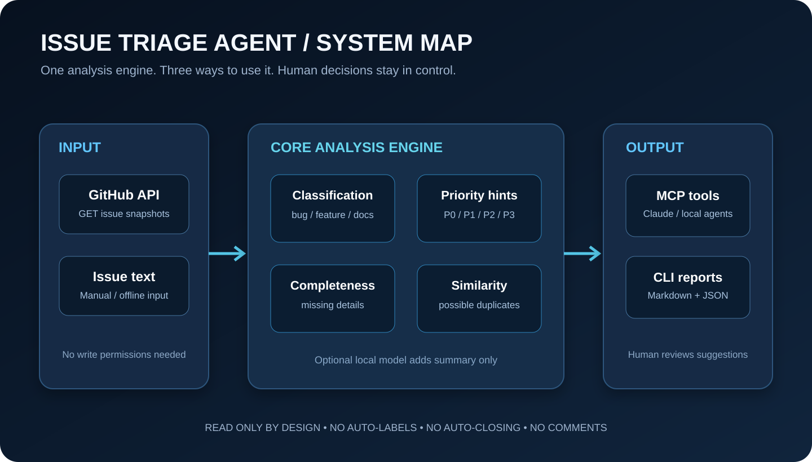
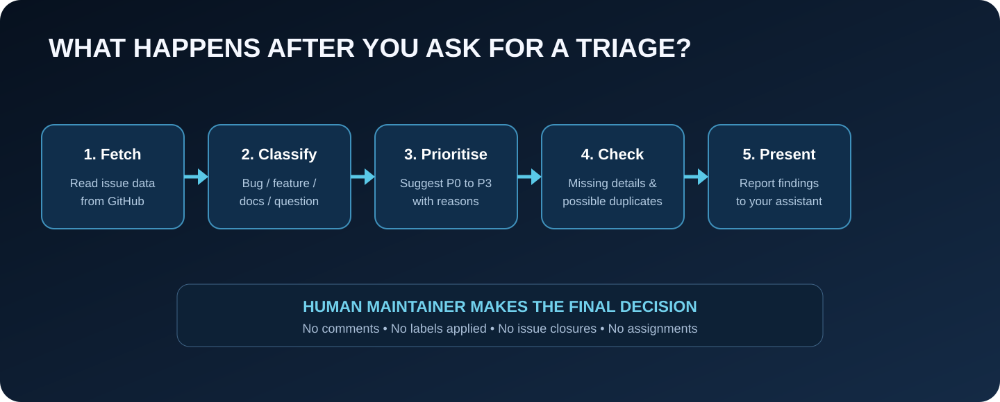

# Architecture

## Design goal

Issue Triage Agent produces a useful first-pass snapshot of a GitHub issue backlog while preserving maintainer control. The project separates the core analysis logic from the interfaces used to access it. This lets a human run it from a terminal, or an AI assistant call the same logic as tools over MCP.

## High-level structure

| Layer | Files | Responsibility |
|---|---|---|
| Data input | `github.py`, `models.py` | Fetch issue pages through GitHub GET endpoints and normalise data into `Issue` objects. |
| Analysis | `analyzer.py`, `similarity.py`, `service.py` | Classify, assign provisional priority, check completeness, find possible duplicate candidates, and prepare structured results. |
| Interfaces | `cli.py`, `mcp_server.py` | Expose the same analysis to terminal users and MCP-compatible AI hosts. |
| Optional enrichment | `llm.py` | Add a bounded summary and follow-up question through an OpenAI-compatible local model endpoint. |
| Outputs | `report.py` | Write Markdown and JSON reports for command-line runs. |

## MCP tools

The server is created in `mcp_server.py` using the official Python MCP SDK. It exposes three tools:

1. `triage_github_repository(repository, state, limit)` fetches and analyses a repository's issues. The MCP limit is capped at 100 to keep responses useful for agent context windows.
2. `triage_issue_text(title, body, labels)` analyses a single pasted issue draft without any network request.
3. `explain_triage_rules()` describes the categories, priorities, duplicate logic, and safety boundaries.

Each tool carries a read-only annotation. This annotation is a hint to MCP hosts, not a security barrier. The actual protection is that the server exposes only read-only functions and its GitHub client performs GET requests only.

## Core processing sequence

1. Parse the repository as `owner/name` or as a GitHub repository URL.
2. Fetch issues with a maximum page size of 100. GitHub's issues endpoint may also return pull requests, so pull requests are filtered out.
3. Convert each API payload into an `Issue` dataclass.
4. Apply existing label mappings before keyword classification rules.
5. Assign a provisional priority, preferring explicit priority labels before impact phrases and defaults.
6. Check whether the report appears to include reproduction steps, expected/actual behaviour, and environment information where appropriate.
7. Compare issue titles and bodies to surface a few high-scoring lexical similarity candidates.
8. Build a compact structured result for the MCP host, or write Markdown and JSON files through the CLI.

## Shared service layer

`service.py` is the shared application layer. Both the CLI and MCP server use the same analysis functions. The MCP adapter does not implement a separate classifier. This reduces the risk that a terminal run and an assistant call produce different category or priority logic.

`build_triage_payload` deliberately omits entire issue bodies from its response. It includes the title, URL, current labels, category, priority, confidence, rationale, suggested labels, missing-information checks, and duplicate candidates. This keeps MCP responses shorter and reduces unnecessary copying of user-submitted issue text into an assistant context.

## Transport choices

- **stdio:** the host launches a local Python process and exchanges MCP messages through standard input/output. This is the recommended personal-computer transport and the default.
- **Streamable HTTP:** the server listens on an HTTP endpoint, normally `http://127.0.0.1:8000/mcp`. This is for controlled local testing or a secured remote deployment. Do not expose the starter server to the public internet without authentication and HTTPS.

The current MCP Python SDK documentation identifies stdio for local servers and Streamable HTTP for deployed servers. The older SSE transport is not used in this project.

## Design decisions

### Read-only boundary

The GitHub client constructs GET requests only. There are no functions for comments, labels, assignments, issue edits, or issue closures. Suggested labels appear only in the report.

### Rules before language models

Category and priority are generated by visible Python rules. The optional local model can add only a short summary and a follow-up question; it cannot alter deterministic fields.

### Similarity is not deduplication

The duplicate detector is based on lexical overlap and string similarity. It presents candidates for maintainer review and never closes, links, or merges an issue.

### Offline fixtures

The `--input-json` option accepts a saved GitHub issues API response. It enables reproducible tests and examples without a network request.

## Trust boundaries

- GitHub issue titles and bodies are untrusted user-generated content.
- The optional local model is instructed not to follow instructions embedded in issue text.
- Model output is restricted to two bounded text fields and is not fed back into the rule engine.
- MCP tools return structured summaries and should not be given more repository access than necessary.
- GitHub tokens are read from environment variables and are not included in report payloads.
- MCP read-only annotations are advisory. The underlying server implementation must remain read-only.

## Known algorithmic limitations

Keyword rules may not understand project-specific terminology. Priority phrases cannot measure actual impact. Duplicate detection may miss paraphrases or flag issues that share terminology but are not duplicates. Completeness checks may fail to recognise unusual phrasing. Pairwise similarity is quadratic in the number of issues, so the CLI caps runs at 500 and the MCP tool caps them at 100. The tool produces a snapshot and does not maintain history.
