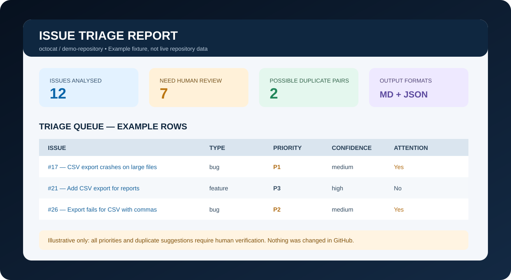

# Evaluation and verification

## What has been tested

The automated test suite covers:

- Repository identifier parsing and rejection of non-GitHub hosts.
- GitHub issue fetching through mocked HTTP responses.
- Pull-request exclusion from GitHub's issue endpoint results.
- Category selection using labels and wording.
- Provisional priority rules.
- Missing-information checks.
- Duplicate-candidate scoring and threshold behaviour.
- Markdown and JSON report generation.
- CLI execution on a synthetic offline fixture.
- Local-model response parsing and the rule that enrichment cannot override category or priority.
- Shared service output for MCP-compatible structured payloads.
- Importability of the MCP server and default stdio transport when the MCP extra is installed.

Run the suite locally:

```bash
python -m pip install -e ".[test,mcp]"
python -m pytest
```

The CI workflow tests Python 3.10 through 3.13 and installs the MCP extra, so the MCP server module is import-checked as part of the build.

## What has not been established

The tests use synthetic issue data and mocked HTTP responses. They do not establish classification accuracy on a large real-world corpus, calibrated confidence, real-world duplicate precision/recall, or the safety of every possible issue text. There is no independently annotated benchmark in this repository. Do not describe the current rule engine as a high-accuracy AI classifier.

A live MCP client connection should be smoke-tested in the target host after installation. Host behaviour, available features, and account permissions can change independently of this project.

## Example fixture

`examples/sample_issues.json` contains deliberately similar synthetic CSV-export issues. `examples/sample_report.md` and `examples/sample_report.json` show the expected kind of output. The issue titles and URLs are illustrative and must not be mistaken for real GitHub issue evidence.



## Interpreting test results

A passing unit test means that the tested function behaves as expected for the fixture and assertion. It does not prove that the same heuristic is correct for every repository. A high similarity score means that two texts share words or patterns, not that one issue should be closed. A P0 phrase means that a high-impact phrase was detected, not that an incident has been verified.


## Phase 1: IssueDupesLite benchmark preparation

The reproducible preparation workflow lives in the evaluation/benchmark folder. It downloads [Primordic/IssueDupesLite](https://huggingface.co/datasets/primordic/IssueDupesLite), resolves and records the dataset revision, extracts source-labelled positive pairs, samples same-repository weak negatives, and assigns entire repositories—not individual pairs—to train/validation/test splits.

Important evaluation caveats:

- The source card declares CC-BY-SA-4.0. Generated derivatives retain attribution and a share-alike notice in ATTRIBUTION.md.
- The dataset viewer reports 10,000 rows and 992 repository values, while the card prose says "10 issue pairs from 1,000 repositories". The preparation script records actual loaded counts.
- The source warns that some genuine duplicates are not labelled. Generated non-linked pairs are therefore weak/unverified negatives, not verified ground-truth non-duplicates.
- A source primary issue can have a later creation timestamp than its duplicate. The output preserves source roles and separately records chronological historical/incoming issue IDs.
- All rows for one repository stay in one split to reduce repository-level leakage.

Install the optional dependency and run:

~~~powershell
python -m pip install -e '.[benchmark,test]'
python -m evaluation.benchmark.prepare_benchmark --seed 42
~~~

Generated source-derived data is placed in evaluation/benchmark/generated/, which is ignored by Git. This avoids accidentally committing a large copy of third-party issue text. The generated manifest records the source revision, dataset fingerprint, preparation settings, counts, and split distribution.

This is a data-preparation milestone only. No duplicate-detection algorithm has been changed and no real-world precision/recall result is claimed until the prepared benchmark has been generated, checked, and evaluated.


## GitHub Actions benchmark artifact

The workflow at .github/workflows/benchmark-data.yml downloads IssueDupesLite on a GitHub-hosted runner, runs the benchmark preparation unit tests, generates the dataset, validates repository isolation and pair uniqueness, and uploads the generated benchmark directory as an Actions artifact with a 30-day retention period.

The artifact is not committed to the source repository. This is intentional because it contains third-party issue text from the CC-BY-SA-4.0 source dataset. Keep ATTRIBUTION.md with any derived benchmark data you download.


## Phase 2: current duplicate detector baseline

A reproducible evaluator now measures the existing duplicate scorer without changing it. It reuses `analyse_issue` to obtain the categories that the production scorer expects, then calls the production `similarity_score` function for each prepared issue pair. The current `0.48` candidate threshold is retained.

Run the evaluator after preparing the benchmark:

~~~powershell
python -m evaluation.benchmark.evaluate_baseline --test-csv evaluation/benchmark/generated/test.csv --manifest evaluation/benchmark/generated/manifest.json --output-dir evaluation/benchmark/generated/baseline
~~~

Outputs are `baseline_metrics.json`, `baseline_scores.csv`, and `baseline_report.md`. The Actions workflow runs this evaluator on the held-out test split and includes the files in the generated benchmark artifact.

### Initial result

Using IssueDupesLite revision `902b5805afa93e8cb018bd3c860c0f3eba55029e`, the test split contained 2,982 pairs from 150 repositories, balanced between 1,491 source-annotated duplicate pairs and 1,491 weak/unverified negatives. At threshold 0.48, the unchanged detector produced:

- Accuracy: 54.33%
- Precision: 87.28%
- Recall: 10.13%
- F1: 18.15%
- Specificity: 98.52%
- ROC AUC: 64.10%
- Average precision: 65.66%

The confusion counts were 151 true-positive labels flagged, 22 weak-negative labels flagged, 1,469 weak-negative labels not flagged, and 1,340 source-positive labels missed.

Interpretation: among the pairs flagged by the current threshold, 87.28% carried a positive source label. However, only 10.13% of source-labelled positives crossed the threshold. This is a high-precision / low-recall operating point on this particular pair benchmark.

The negative labels are unverified and may contain undiscovered duplicates. Therefore, a pair counted as a false positive may be a missed source annotation rather than a genuine detector mistake. The numbers measure agreement with the dataset labels, not proven real-world accuracy. The score is pairwise and does not establish top-three retrieval quality in a live repository scan.

The test split must remain untouched for later final comparisons. Threshold tuning and algorithm experiments should use the validation split. No detector logic was changed in this baseline step.


## Phase 3: compare similarity methods (validation only)

The completed GitHub Actions run compared four methods on the same 2,984 validation pairs from 150 repositories. The 13,908 training pairs were used to select each method's threshold and to fit the hybrid scaling. Those settings were then frozen before validation was evaluated. The held-out test split was not used for Phase 3 selection.

The embedding model was sentence-transformers/all-MiniLM-L6-v2, run locally on CPU. No paid API key or hosted LLM call was used.

### Full validation comparison

| Method | ROC AUC | Average precision | F1 at training-selected threshold | MRR@3 | Recall@3 |
|---|---:|---:|---:|---:|---:|
| Existing lexical | 0.6541 | 0.6419 | 0.6804 | 0.8102 | 0.9933 |
| BM25 | 0.7031 | 0.6780 | 0.7060 | 0.8712 | 0.9967 |
| Semantic embeddings | 0.8120 | 0.7893 | 0.7637 | 0.9158 | 0.9967 |
| Hybrid | 0.7918 | 0.7614 | 0.7539 | 0.9178 | 1.0000 |

Semantic embeddings led on ROC AUC, average precision and F1. The hybrid had a very small advantage on MRR@3 and Recall@3. This makes semantic embeddings the strongest provisional candidate on the overall pair-ranking/classification measures, but it does not yet justify a production change.

### Thresholds selected using training data

| Method | Training-selected threshold |
|---|---:|
| Existing lexical | 0.093209 |
| BM25 | 5.445388 |
| Semantic embeddings | 0.426541 |
| Hybrid | 0.412911 |

The thresholds are not directly comparable because each method has a different score scale. All four were selected using training labels, then applied unchanged to validation.

The top-three retrieval metrics use 598 eligible incoming-issue groups. A group is eligible only when it has at least two sampled candidates and at least one source-positive candidate; single-candidate groups are excluded.

### What these results mean

ROC AUC measures how well a method orders a randomly selected source-positive pair above a weak-negative pair. Average precision summarises how highly the source-positive pairs appear when all pairs are ranked. F1 combines precision and recall after applying a threshold. MRR@3 rewards finding the first source-positive candidate near the top of a short list; Recall@3 measures how many source-positive candidates appear in the first three positions.

These are benchmark-label comparisons, not independently verified real-world accuracy measurements. Source-positive pairs are recorded duplicate links; weak negatives are unlinked pairs that may contain undiscovered duplicates. A method can therefore be penalised for flagging an unlinked pair that is actually a genuine duplicate.

### Reproducing the comparison

After preparing the benchmark, install the optional dependencies and run:

~~~powershell
python -m pip install -e '.[benchmark,test,similarity-experiments]'
python -m evaluation.benchmark.evaluate_similarity_methods --train-csv evaluation/benchmark/generated/train.csv --validation-csv evaluation/benchmark/generated/validation.csv --model sentence-transformers/all-MiniLM-L6-v2 --output-dir evaluation/benchmark/generated/phase3
~~~

The comparison writes `similarity_comparison.json`, `similarity_scores.csv`, and `similarity_comparison_report.md`.

## Phase 4: validation error analysis and human review

Phase 4 inspects where the four methods disagree and which validation examples deserve a person’s attention. It uses the saved Phase 3 scores and the validation rows. It does not re-train the model, change thresholds, read the held-out test split, or modify the production detector.

### Results at the training-selected thresholds

| Method | TP source labels | Weak-negative alerts | Weak negatives not flagged | Source-positive low scores | Precision | Recall | F1 |
|---|---:|---:|---:|---:|---:|---:|---:|
| Existing lexical | 1,390 | 1,204 | 288 | 102 | 0.5359 | 0.9316 | 0.6804 |
| BM25 | 1,315 | 918 | 574 | 177 | 0.5889 | 0.8814 | 0.7060 |
| Semantic embeddings | 1,296 | 606 | 886 | 196 | 0.6814 | 0.8686 | 0.7637 |
| Hybrid | 1,320 | 690 | 802 | 172 | 0.6567 | 0.8847 | 0.7539 |

The labels in this table are intentionally described as “weak-negative alerts” and “source-positive low scores.” They correspond to the false-positive and false-negative cells in a conventional confusion matrix, but the underlying negative labels have not been confirmed by human reviewers.

### How the weak-negative results differ

| Method | Hard lexical negatives flagged | Random same-repository negatives flagged |
|---|---:|---:|
| Existing lexical | 736 / 742 (99.19%) | 468 / 750 (62.40%) |
| BM25 | 567 / 742 (76.42%) | 351 / 750 (46.80%) |
| Semantic embeddings | 442 / 742 (59.57%) | 164 / 750 (21.87%) |
| Hybrid | 497 / 742 (66.98%) | 193 / 750 (25.73%) |

The semantic method raised fewer alerts on both sampled weak-negative groups at its training-selected threshold. That may mean fewer distracting candidate suggestions, but it is not proof that every alert it avoids is wrong: some weak negatives may actually be duplicates that were never linked in the source dataset.

### Human-review pack

The analysis selected the top 10 highest-scoring weak-negative pairs and bottom 10 source-positive low-score pairs for each method. Duplicate examples selected by multiple methods were included once per review reason, producing **56 unique review rows**.

The diagnostic `review_examples.csv` includes issue titles, shortened body excerpts, source label quality, sample type, all four scores and thresholds. Do not give this file to an adjudicator as the first view because its labels and model scores can bias judgement.

The separate `reviewer_blind.csv` is the reviewer-facing file. It includes canonical GitHub links to both issues, titles, shortened descriptions, and blank adjudication fields, while omitting source labels, sample types, model names, scores, and selection reasons. `HUMAN_REVIEW_GUIDE.md` defines the four decisions (`same_underlying_issue`, `related_but_distinct`, `different_issues`, and `insufficient_context`), the confidence scale, and how to review independently.

### Reproduce Phase 4

Run the following after Phase 3 has produced its files:

~~~powershell
python -m evaluation.benchmark.analyze_similarity_errors --validation-csv evaluation/benchmark/generated/validation.csv --scores-csv evaluation/benchmark/generated/phase3/similarity_scores.csv --comparison-json evaluation/benchmark/generated/phase3/similarity_comparison.json --output-dir evaluation/benchmark/generated/phase4 --top-n 10
~~~

The command writes:
- `error_analysis_summary.json` — machine-readable metrics and prediction disagreement counts.
- `error_analysis_report.md` — a readable summary of the findings and limitations.
- `review_examples.csv` — selected issue pairs for human adjudication.

The Phase 4 analyser uses only the Python standard library. It validates that validation and score files contain the same pair IDs, labels and repositories before producing results. Its tests cover metric calculation, review selection, file generation and mismatched input rejection.

### Phase 5 status: evidence audit and human review

All 56 selected pairs received a separate AI-assisted evidence assessment based on original issue descriptions and available discussion comments. The preliminary breakdown is 26 likely same underlying issue, 16 related but distinct, 13 different, and 1 insufficient context. These are diagnostic AI assessments only, not independent human adjudications and not replacements for source labels. The reviewer workbook remains blinded and its decision fields are still blank. Independent human review remains outstanding.

### Phase 6: freeze the candidate-ranking method and evaluate once

The product is intended to show developers a short ranked list of possible duplicates. On validation, Hybrid had the highest MRR@3 (0.917781) and Recall@3 (1.0000) of the four methods; Semantic had the best pairwise F1 (0.763701). We therefore froze Hybrid for Phase 6 because top-three candidate ranking is the primary product objective. This is a use-case decision, not a claim that Hybrid is best at every metric.

The frozen configuration is recorded in `evaluation/frozen_hybrid_config.json`: equal BM25/Semantic weighting, `sentence-transformers/all-MiniLM-L6-v2`, maximum sequence length 256, top 3 candidates, and the threshold 0.41291124292046016 selected on training data. The new `evaluation.frozen_hybrid` runner checks dataset revision, fingerprint, repository separation, pair IDs, and the training-derived threshold before evaluating the held-out test split. It does not tune on test labels.

Run the evaluator directly after Phase 1–4 artifacts exist:

~~~powershell
python -m evaluation.frozen_hybrid --train-csv evaluation/benchmark/generated/train.csv --test-csv evaluation/benchmark/generated/test.csv --manifest evaluation/benchmark/generated/manifest.json --config evaluation/frozen_hybrid_config.json --model sentence-transformers/all-MiniLM-L6-v2 --output-dir evaluation/benchmark/generated/phase6
~~~

It writes `phase6_final_test.json`, `phase6_final_test_report.md`, `test_pair_scores.csv`, `top3_ranked_candidates.csv`, and a frozen configuration snapshot. The benchmark workflow now runs this after Phase 4 and uploads the outputs with the rest of the artifact.

The test result is a one-time final measurement. Do not change the method, threshold, weights, preprocessing or ranking rule after reading it. If the method needs changes, use a new validation set and reserve a new untouched test set. The agent remains read-only: it may recommend candidates but must not close issues, add labels, assign people or post comments.

### Reproducible run and artifact

The latest completed pre-Phase-6 artifact is from [run 41362182100](https://github.com/yerageracharan/issue-triage-agent/actions/runs/41362182100), artifact `issuedupeslite-benchmark-24` (ID `13106605066`). The updated Phase 6 workflow is [run 41366209127](https://github.com/yerageracharan/issue-triage-agent/actions/runs/41366209127); it now executes the frozen hybrid test evaluator after Phase 4 and uploads the Phase 6 report and CSV outputs. Its final status and artifact should be recorded only after that run completes. The blind reviewer CSV and separate 56-pair reviewer workbook remain available; independent human labels are still pending. Artifacts are temporary and have a 30-day retention period.

The governing limitations remain: source positives are not independently re-labelled; unlinked negatives are weak and unverified; validation is used for method investigation rather than final performance claims; and similarity is evidence for human inspection, not proof of a shared root cause.
